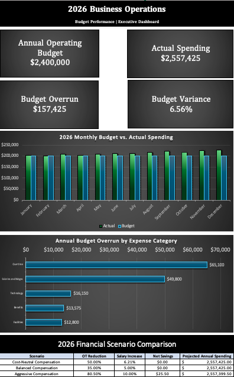

# Business Operations Budget & Resource Planning Analysis

### Excel Portfolio Project | Financial Analysis • Scenario Modeling • Resource Planning

## Project Overview

This project demonstrates operational budget management, financial variance analysis, resource planning, and executive reporting using Microsoft Excel.

The analysis examines a fictional business operations department with a $2.4 million annual operating budget. Using simulated financial and staffing data, the project investigates spending patterns, identifies budget overruns, and evaluates potential cost-management strategies.

**Reporting Period:** January–December 2026  
**Primary Tool:** Microsoft Excel  
**Data Classification:** 100% Simulated

## Executive Dashboard

The executive dashboard brings together annual financial performance, monthly spending trends, expense-category variances, and scenario comparisons.

[Download the Excel Workbook](Business_Operations_Budget_Analysis.xlsx)

## Key Performance Indicators

| Metric | Result |
|---|---:|
| Annual Operating Budget | $2,400,000 |
| Actual Annual Spending | $2,557,425 |
| Annual Budget Overrun | $157,425 |
| Budget Variance | +6.56% |
| Largest Expense Overrun | Overtime |

## Business Problem

The fictional operations department exceeded its annual budget, with spending increasing throughout the year.

The project addresses four questions:

1. Which expense categories contributed most to the budget overrun?
2. How did spending change throughout the reporting period?
3. Could alternative compensation and overtime strategies reduce expenses?
4. Would proposed overtime reductions be operationally sustainable?

## Financial Analysis

### Budget vs. Actual Performance

Annual expenses exceeded the operating budget by $157,425, approximately 6.56%.

Actual spending exceeded planned spending in every month of the simulated reporting period.

### Expense Variance Analysis

Overtime was the largest contributor to unfavorable budget variance:

- Overtime spending exceeded budget by $65,100.
- Overtime accounted for approximately 41.4% of the total annual budget overrun.
- Salaries, benefits, technology, and facilities also contributed to overall unfavorable variance.

These findings identify overtime utilization as an important area for management review.

## Scenario Analysis

Excel formulas and Goal Seek were used to evaluate hypothetical compensation and cost-management strategies.

| Scenario | Overtime Reduction | Salary Increase | Modeled Net Savings |
|---|---:|---:|---:|
| Cost-Neutral Compensation | 50.0% | Approximately 6.21% | $0 |
| Balanced Compensation | 35.0% | 5.0% | $3,102.50 |
| Aggressive Compensation | 80.5% | 10.0% | $25.50 |

The Balanced scenario generated the largest modeled savings among the three scenarios.

However, none of the scenarios eliminated the original annual budget overrun.

The scenario calculations are illustrative and assume that salary adjustments do not create additional employer benefit costs.

## Resource Planning Analysis

To evaluate the operational implications of reducing overtime, a simplified staffing-capacity model was developed.

| Resource Metric | Modeled Result |
|---|---:|
| Current Employees | 30 |
| Annual Productive Capacity | 49,920 hours |
| Annual Workload Demand | 65,000 hours |
| Productive Workload Gap | 15,080 hours |
| Additional Productive Overtime Capacity | Approximately 4,278 hours |
| Remaining Capacity Shortfall | Approximately 10,802 hours |
| Additional FTE Required After Overtime | Approximately 7 |

The results suggest that reducing overtime without increasing regular staffing capacity or improving productivity could worsen the department's existing workload shortfall.

## Management Recommendations

**1. Review overtime utilization.** Investigate workload distribution, scheduling practices, and opportunities to reduce avoidable overtime without compromising service delivery.

**2. Evaluate staffing capacity before reducing overtime.** Compare additional staffing costs, workload demand, and operational requirements before implementing compensation-reallocation scenarios.

**3. Investigate recurring expense overruns.** Use monthly variance reporting to identify cost pressures earlier and improve budget planning.

**4. Evaluate compensation strategies alongside operational outcomes.** Salary increases may offer workforce benefits, but their effects on employee retention and productivity would require additional evidence.

## Excel Skills Demonstrated

- Budget vs. actual variance analysis
- SUM, SUMIF, IF, IFERROR, and other Excel formulas
- Dynamic cross-worksheet calculations
- Financial scenario modeling
- Goal Seek and break-even analysis
- Resource capacity and FTE calculations
- Excel charts and executive dashboard development
- Management reporting and operational recommendations

## Workbook Structure

| Worksheet | Purpose |
|---|---|
| Assumptions | Financial inputs and planning parameters |
| Budget vs. Actual | Monthly expenses, annual summaries, and variance analysis |
| Scenario Analysis | Compensation and cost-reduction scenarios |
| Resource Planning | Staffing availability, workload requirements, and capacity gaps |
| Executive Dashboard | Financial KPIs, charts, and management findings |

## Limitations

This project uses entirely simulated data. It is intended to demonstrate financial analysis and decision-support methods rather than provide real-world business recommendations.

The resource model uses simplified assumptions about staffing availability, productivity, overtime costs, and workload demand. Proposed overtime reductions have not been established as operationally feasible.

## Professional Context

This project builds on more than 11 years of experience in Workforce Management and operational analysis, including staffing, forecasting, resource planning, and executive reporting.

It demonstrates how established operational analysis skills can be applied to financial planning, budget performance, and business decision support.

---

*All financial, employee, and operational information in this project is fictional and contains no proprietary employer data.*
